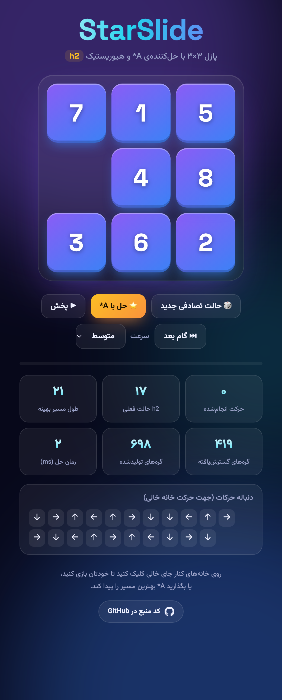
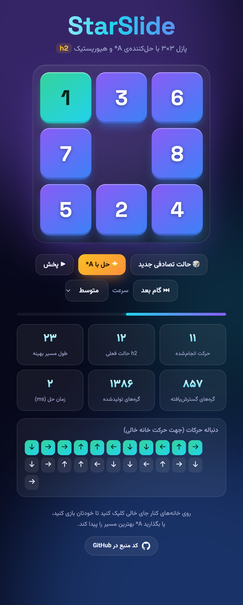
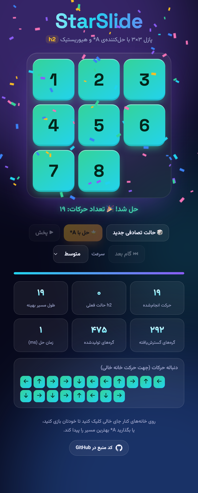

<div align="center">

# StarSlide ⭐

<p dir="rtl"><b>حل پازل ۳×۳ (۸-پازل) با الگوریتم A* و هیوریستیک h2</b></p>

<p>
  <a href="https://starslide.emadhabibnia.ir"></a>
  
  
  
</p>

<p dir="rtl">
  <a href="https://starslide.emadhabibnia.ir">🎮 اجرای آنلاین</a> &nbsp;·&nbsp;
  <a href="#الگوریتم">الگوریتم</a> &nbsp;·&nbsp;
  <a href="#نتایج-تست">نتایج تست</a>
</p>

<p>
  <a href="./README.md">English</a> &nbsp;·&nbsp; <b>فارسی</b>
</p>

<br>

<table>
  <tr>
    <td align="center"></td>
    <td align="center"></td>
    <td align="center"></td>
  </tr>
  <tr>
    <td align="center" dir="rtl"><sub>مسیر بهینه با A*</sub></td>
    <td align="center" dir="rtl"><sub>در حال پخش</sub></td>
    <td align="center" dir="rtl"><sub>حل شد</sub></td>
  </tr>
</table>

</div>

<div dir="rtl">

## صورت مسئله

بازی از یک حالت **تصادفی** شروع می‌شود و باید با لغزاندن مهره‌ها به خانه‌ی خالی، به حالت هدف رسید. برنامه با **A\*** و تابع هیوریستیک **h2** بهترین (کوتاه‌ترین) دنباله‌ی حرکات را از حالت شروع تا هدف پیدا می‌کند و آن را نمایش و اجرا می‌کند.

</div>

<div align="center">

```
1 2 3
4 5 6
7 8 _
```

<sub dir="rtl">حالت هدف</sub>

</div>

<div dir="rtl">

## امکانات

- تولید حالت شروع تصادفی که **همیشه قابل‌حل** است (بررسی با شمارش وارونگی‌ها)
- بازی دستی با کلیک روی مهره‌ها، همراه با نمایش لحظه‌ای مقدار <code dir="ltr">h2</code>
- حل با A\* و نمایش دنباله‌ی بهینه‌ی حرکات (جهت حرکت خانه‌ی خالی)
- پخش خودکار یا گام‌به‌گام مسیر حل، با سرعت قابل تنظیم
- آمار جست‌وجو: طول مسیر بهینه، گره‌های گسترش‌یافته و تولیدشده، زمان حل
- جاوااسکریپت خالص؛ بدون وابستگی، بدون سرور، فقط یک صفحه‌ی ثابت

## الگوریتم

<div dir="ltr" align="center">

**f(n) = g(n) + h2(n)**

</div>

- <code dir="ltr">g(n)</code> — تعداد حرکات از حالت شروع تا گره n
- <code dir="ltr">h2(n)</code> — مجموع فاصله‌ی منهتن هر مهره از خانه‌ی هدفش

**چرا جواب بهینه است؟** هر حرکت فقط یک مهره را یک خانه جابه‌جا می‌کند، پس h2 در هر حرکت حداکثر ۱ واحد تغییر می‌کند. نتیجه:

- h2 **قابل‌قبول** (admissible) است: هرگز هزینه‌ی واقعی را بیشتر از مقدار واقعی تخمین نمی‌زند.
- h2 **سازگار** (consistent) است: <code dir="ltr">h(n) ≤ 1 + h(n′)</code>.

با هیوریستیک سازگار، اولین باری که حالت هدف از صف خارج شود، کوتاه‌ترین مسیر پیدا شده است و هیچ گره‌ای نیاز به باز شدن دوباره ندارد.

</div>

<div dir="ltr">

```text
open  ← min-heap ordered by f = g + h2 (ties: lower h2 first)
push start with g = 0
while open is not empty:
    n ← pop the node with the lowest f
    if n is in closed: continue
    add n to closed
    if n is the goal: return the path via parent links
    for each state s reached by sliding one tile into the blank:
        g' ← g(n) + 1
        if s is in closed or g' ≥ best g known for s: skip
        push s with f = g' + h2(s)
```

</div>

<div dir="rtl">

صف اولویت با **Min-Heap** پیاده‌سازی شده است و حالت‌های تکراری با مجموعه‌ی <code dir="ltr">closed</code> و بهترین <code dir="ltr">g</code> شناخته‌شده حذف می‌شوند.

## نتایج تست

درستی الگوریتم با یک مرجع مستقل سنجیده شده است: یک BFS از حالت هدف، فاصله‌ی واقعی **همه‌ی ۱۸۱٬۴۴۰ حالت قابل‌دسترس** را می‌دهد و طول مسیر A\* برای ۳۰۰ حالت تصادفی با آن مقایسه می‌شود.

<div dir="ltr">

```text
$ node tests/verify.js
reachable states (BFS): 181440
deepest state: 31 moves
random starts solved: 300
non-optimal or invalid results: 0
max nodes expanded: 5563, max time: 3 ms
```

</div>

یعنی در هر ۳۰۰ حالت، مسیر A\* دقیقاً کوتاه‌ترین مسیر ممکن بود. سخت‌ترین حالت‌های ۸-پازل ۳۱ حرکت لازم دارند و حل آن‌ها هم چند میلی‌ثانیه طول می‌کشد.

## ساختار پروژه

| فایل | توضیح |
| --- | --- |
| <code dir="ltr">index.html</code> | صفحه‌ی اصلی |
| <code dir="ltr">css/style.css</code> | ظاهر بازی |
| <code dir="ltr">js/puzzle.js</code> | مدل پازل: حالت‌ها، h2، حرکت، قابل‌حل بودن |
| <code dir="ltr">js/astar.js</code> | الگوریتم A\* و Min-Heap |
| <code dir="ltr">js/confetti.js</code> | انیمیشن جشن پیروزی |
| <code dir="ltr">js/app.js</code> | رابط کاربری |
| <code dir="ltr">tests/verify.js</code> | بررسی بهینه‌بودن A\* با BFS |
| <code dir="ltr">docs/screenshots/</code> | تصاویر |

</div>

<div dir="rtl">

## اجرا

فایل <code dir="ltr">index.html</code> را در مرورگر باز کنید، یا یک سرور ساده بالا بیاورید:

</div>

```bash
npx serve .
```

<div dir="rtl">

اجرای تست:

</div>

```bash
node tests/verify.js
```

<div dir="rtl">

## انتشار

بازی یک سایت ثابت است و روی هر وب‌سرور (nginx، GitHub Pages و غیره) اجرا می‌شود. نسخه‌ی آنلاین: **https://starslide.emadhabibnia.ir**

</div>
