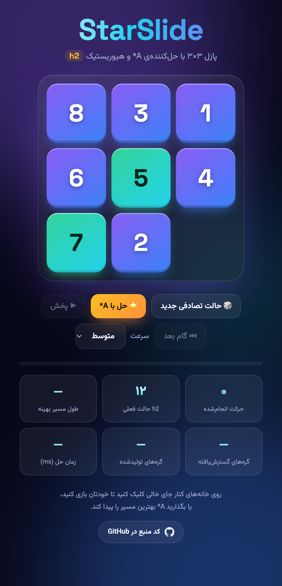
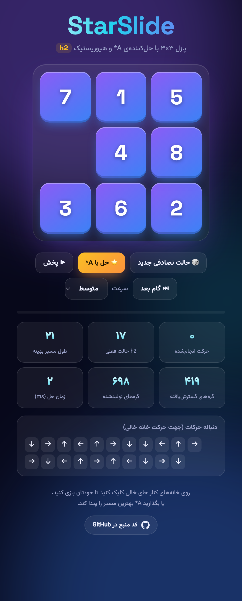
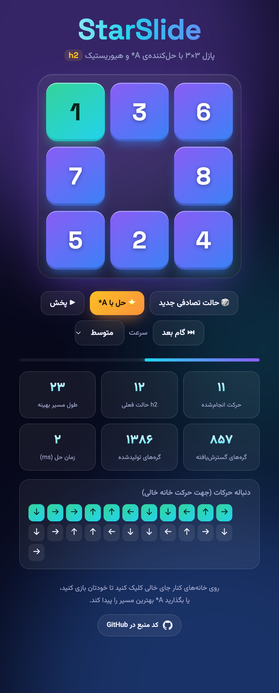
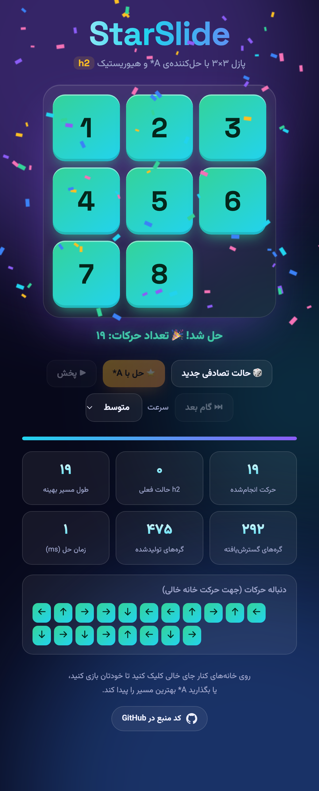

# StarSlide ⭐

بازی پازل ۳×۳ (۸-پازل) که از یک حالت تصادفی شروع می‌شود و با الگوریتم **A\*** و تابع هیوریستیک **h2** (مجموع فاصله‌ی منهتن) کوتاه‌ترین دنباله‌ی حرکات تا حالت هدف را پیدا می‌کند.

پروژه‌ی درس هوش مصنوعی — جاوااسکریپت خالص، بدون وابستگی و بدون نیاز به سرور.

🔗 **اجرای آنلاین:** https://starslide.emadhabibnia.ir

## تصاویر

| شروع (حالت تصادفی) | حل با A* | حل در حال پخش | حل شد |
|:--:|:--:|:--:|:--:|
|  |  |  |  |

## حالت هدف

```
1 2 3
4 5 6
7 8 _
```

## امکانات

- تولید حالت شروع تصادفی (همیشه قابل‌حل؛ بررسی با شمارش وارونگی‌ها)
- بازی دستی با کلیک روی خانه‌ها
- حل با A\* و نمایش دنباله‌ی بهینه‌ی حرکات (جهت حرکت خانه‌ی خالی)
- پخش خودکار یا گام‌به‌گام مسیر حل
- نمایش آمار جست‌وجو: طول مسیر بهینه، گره‌های گسترش‌یافته و تولیدشده، زمان حل

## الگوریتم

`f(n) = g(n) + h2(n)`

- `g(n)`: تعداد حرکات از حالت شروع تا گره n
- `h2(n)`: مجموع فاصله‌ی منهتن هر مهره از خانه‌ی هدفش

h2 **قابل‌قبول** (admissible) و **سازگار** (consistent) است، پس اولین باری که حالت هدف از صف خارج شود، مسیر پیداشده بهینه است. صف اولویت با Min-Heap پیاده‌سازی شده و گره‌های تکراری با مجموعه‌ی closed حذف می‌شوند.

درستی الگوریتم با مقایسه‌ی طول مسیر A\* و فاصله‌ی واقعی (BFS از حالت هدف روی هر ۱۸۱٬۴۴۰ حالت قابل‌دسترس) برای ۳۰۰ حالت تصادفی بررسی شده است: همه یکسان بودند.

## ساختار پروژه

```
index.html      صفحه‌ی اصلی
css/style.css   ظاهر بازی
js/puzzle.js    مدل پازل: حالت‌ها، h2، حرکت، قابل‌حل بودن
js/astar.js     الگوریتم A* و Min-Heap
js/confetti.js  انیمیشن جشن پیروزی
js/app.js       رابط کاربری
```

## اجرا

فایل `index.html` را در مرورگر باز کنید، یا:

```bash
npx serve .
```

## انتشار روی GitHub Pages

Settings ← Pages ← Source: `main` / `(root)`
